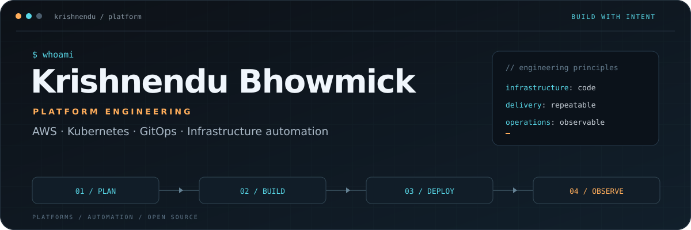
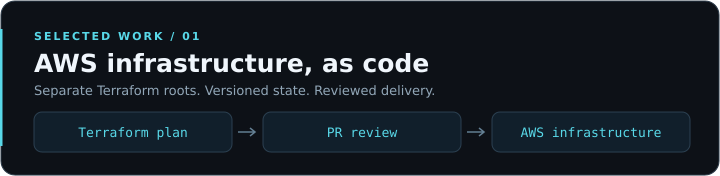
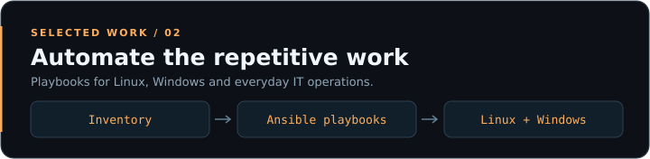
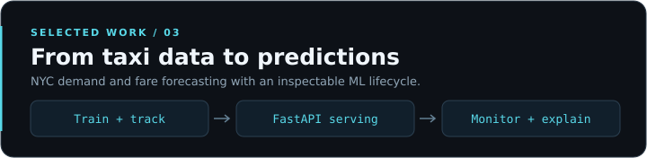

  

  <strong>Senior Platform Engineer III · Nomura Research Institute</strong> 
  AWS Community Builder · Kolkata, India

  <a href="https://bhowmickkrishnendu.github.io/">Portfolio ↗</a> &nbsp;·&nbsp;
  <a href="https://linkedin.com/in/iamkrishnendu">LinkedIn ↗</a> &nbsp;·&nbsp;
  <a href="https://krishnendubhowmick.medium.com/">Writing ↗</a> &nbsp;·&nbsp;
  <a href="mailto:9635.krishnendu@gmail.com">Email ↗</a>

I build and automate cloud infrastructure, delivery pipelines, and platform tooling. My work spans **10+ years** across operations and engineering, with a focus on **AWS, Kubernetes, Terraform, and GitOps**. I’m currently extending that work into **MLOps and AI engineering**.

## Selected work

### 01 · AWS-With-Terraform

Separate Terraform roots for networking, compute, storage, and shared state, with GitHub Actions checks, deployment approvals, and drift workflows.

**Terraform · AWS · GitHub Actions · Infrastructure as Code** 
[Explore the repository →](https://github.com/bhowmickkrishnendu/AWS-With-Terraform) · [Architecture](https://github.com/bhowmickkrishnendu/AWS-With-Terraform/blob/master/docs/architecture.md)

### 02 · AutomateIT-AnsiblePlaybooks

Playbooks for deployments, system administration, monitoring, and Kubernetes setup. Includes selectable DevOps tooling with OS detection and verified downloads.

**Ansible · Linux · Windows · YAML** 
[Explore the repository →](https://github.com/bhowmickkrishnendu/AutomateIT-AnsiblePlaybooks) · [DevOps tooling](https://github.com/bhowmickkrishnendu/AutomateIT-AnsiblePlaybooks/tree/main/Linux/devops-tools)

### 03 · Taxi Forecasting MLOps

An end-to-end NYC taxi demand and fare forecasting project: data processing, model training, experiment tracking, API serving, a dashboard, drift detection, and explainability.

**Python · MLflow · FastAPI · Streamlit** 
[Explore the repository →](https://github.com/bhowmickkrishnendu/taxi-forecasting-mlops) · [Architecture](https://github.com/bhowmickkrishnendu/taxi-forecasting-mlops/blob/main/docs/ARCHITECTURE.md)

## Open source contributions

<!-- PR-STATUS:START -->
| Project | Contribution | Status | Review | CI |
| --- | --- | --- | --- | --- |
| Ansible | [#87676 · Jinja2 prompt validation](https://github.com/ansible/ansible/pull/87676) | 🟢 Open | ⏳ Review required | [⚠️ Stale · passing](https://github.com/ansible/ansible/pull/87676/checks) |
| Argo CD | [#30491 · Helm environment values](https://github.com/argoproj/argo-cd/pull/30491) | 🟢 Open | ⏳ Review required | [✅ Passing](https://github.com/argoproj/argo-cd/pull/30491/checks) |

_Last table update: 27 Oct 2026, 14:42 IST._
<!-- PR-STATUS:END -->

## Core toolkit

**Cloud & platforms** 
   

**Delivery & automation** 
   

**Code & observability** 
   

More tools I work with

- **Cloud & delivery:** Azure, GitLab CI, SonarQube, Nginx.
- **Application tooling:** PowerShell, Groovy, JavaScript, Node.js, Flask.
- **Data & ML:** PostgreSQL, MySQL, DynamoDB, Pandas, NumPy, scikit-learn.

## Latest writing

Practical notes on cloud infrastructure, automation, and engineering.

<!-- BLOG-POST-LIST:START -->
- [How to Mount S3 Buckets as File Systems in AWS &lpar;Amazon S3 Files Tutorial 2026&rpar;](https://krishnendubhowmick.medium.com/amazon-s3-files-native-file-system-access-to-your-s3-data-launched-recently-a320144e6b8e?source=rss-1dad22fc18ce------2)
- [LiteLLM Supply Chain Attack: How Hackers Stole 97M API Keys &lpar;March 2026 Analysis&rpar;](https://krishnendubhowmick.medium.com/they-poisoned-the-package-that-holds-all-your-ai-keys-heres-what-actually-happened-1486cd019a5c?source=rss-1dad22fc18ce------2)
- [Fix CrashLoopBackOff, ImagePullError &amp; OOMKilled: Kubernetes Troubleshooting Guide](https://krishnendubhowmick.medium.com/this-kubernetes-troubleshooting-method-will-make-you-the-hero-on-call-e6bb568479b3?source=rss-1dad22fc18ce------2)
<!-- BLOG-POST-LIST:END -->

[More articles on Medium →](https://krishnendubhowmick.medium.com/)

GitHub activity

 

  

[View my GitHub profile →](https://github.com/bhowmickkrishnendu)

---

**Let’s talk platforms, cloud automation, or MLOps.** 
[Portfolio](https://bhowmickkrishnendu.github.io/) · [LinkedIn](https://linkedin.com/in/iamkrishnendu) · [Email](mailto:9635.krishnendu@gmail.com) · [X](https://x.com/whokrishnendu)

Elsewhere

[Facebook](https://facebook.com/iamkbhowmick)

